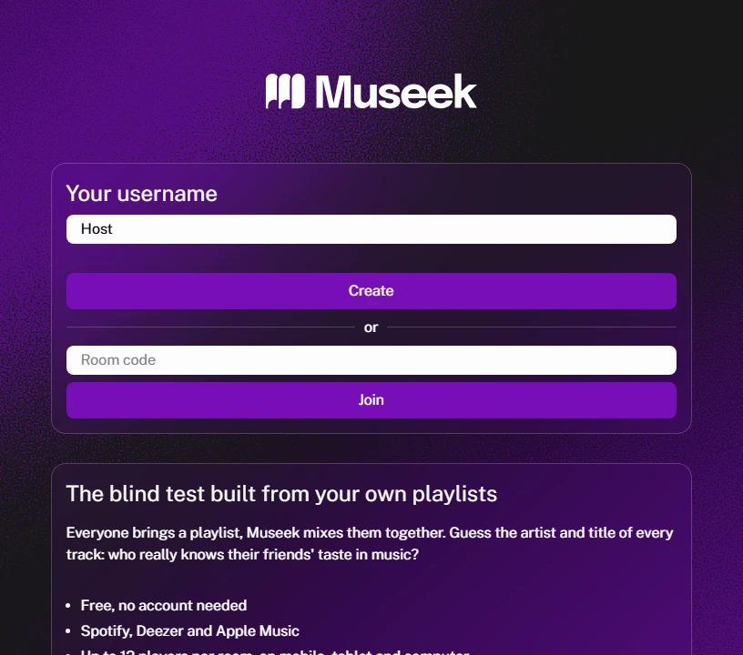
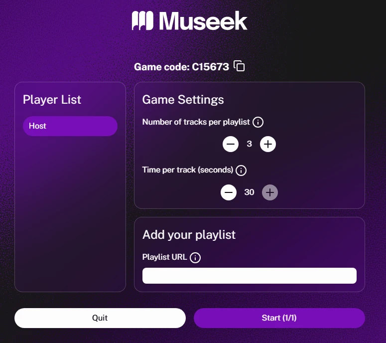
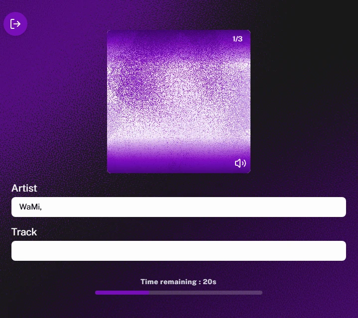
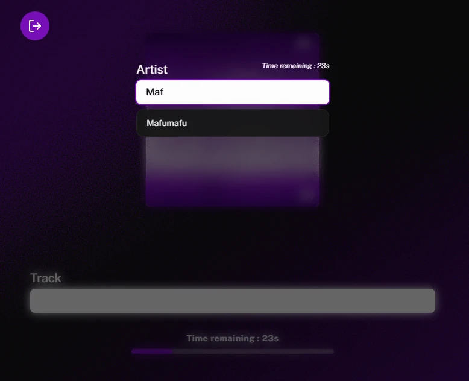
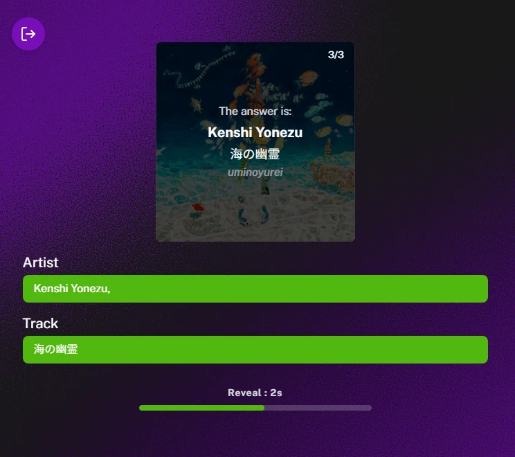
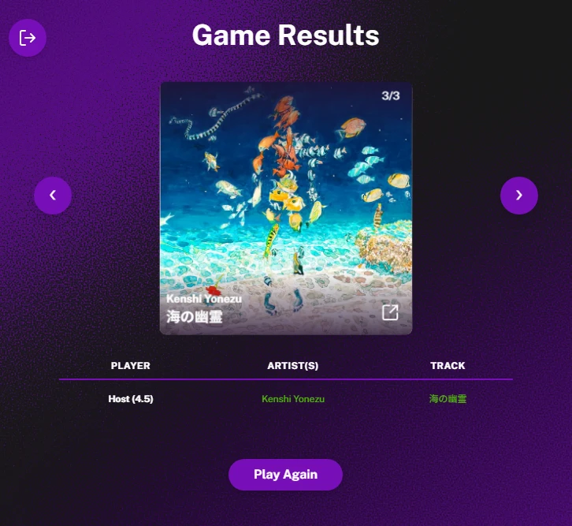

# 🎵 Museek

🇬🇧 English | 🇫🇷 [Français](README.fr.md)

**Museek** is a free online multiplayer music quiz (blind test), no account needed, for up to 12 players, using your own **Spotify**, **Deezer** or **Apple Music** playlists.
Everyone brings a playlist, Museek shuffles the tracks together, and every player who recognises the artist or the title scores points.

🌐 **Play online:** [https://museek.xiao-web.com/](https://museek.xiao-web.com/)

📝 **Technical write-up:** [Building a multiplayer music quiz where everyone brings their own playlist (Next.js + Socket.io)](https://museek.hashnode.dev/building-a-multiplayer-music-quiz-where-everyone-brings-their-own-playlist-next-js-socket-io)



---

## 📸 Preview

| Lobby: settings and playlist | Round: type the artist and the title |
| :---: | :---: |
|  |  |

| Autocomplete | Answer reveal |
| :---: | :---: |
|  |  |

| Results |
| :---: |
|  |

---

## ✨ Features

- **Collaborative blind test**: each player submits the link to one of their favourite playlists. The tracks are shuffled and played in real time. If a playlist can't be loaded, a pop-up warns everyone, players go back to "not ready" so the affected player can fix their link, and playlists that were already loaded are not reloaded on relaunch.
- **Not a race**: speed doesn't count. Everyone scores on every track they know: 1 point for the artist (0.5 if there are several artists and you only find some of them) and 1 point for the title.
- **No built-in chat**: the easiest way to play is in a voice call with your friends (Discord, Zoom…).
- **Multi-platform support**: import public playlists from **Spotify**, **Deezer** and **Apple Music** (https links from these platforms only, short links included; any other link is rejected).
- **Real-time multiplayer**: game rooms created and managed over WebSockets.
- **Customisable settings**: the game creator sets the number of tracks per playlist and the time allowed to guess each track.
- **Typing and autocomplete**: players type the title and/or the artist, with autocomplete and typo tolerance (transliteration, special characters and Japanese support via Kuroshiro, etc.).
- **Privacy by default (GDPR)**: no persistent database. Session data is ephemeral and kept only in memory (RAM) for the duration of the game.

---

## 🛠️ Tech Stack

The project is a **monorepo**:

- **Frontend**:
  - [Next.js](https://nextjs.org/) (React, TypeScript)
  - Styling: CSS / Tailwind CSS
  - Real-time communication: [Socket.io](https://socket.io/) client
- **Backend**:
  - [Node.js](https://nodejs.org/) with [Express](https://expressjs.com/)
  - Real-time server: [Socket.io](https://socket.io/)
  - API integration & scraping: native `fetch` (Spotify, Deezer, iTunes), `cheerio` (Apple Music scraping)
  - Normalisation & transliteration: `kuroshiro`, `kuroshiro-analyzer-kuromoji`, `transliteration`

---

## 📂 Project Structure

```text
music-blender/
├── backend/            # Node.js / Socket.io server
│   ├── scripts/        # Track extraction (Spotify, Deezer, Apple) and transliteration
│   ├── types/          # Game and socket event types
│   ├── tests/          # Tests (see "Tests" below)
│   ├── servor.ts       # Main backend server entry point
│   └── package.json
├── frontend/           # Next.js application
│   ├── src/
│   │   ├── app/        # Next.js config (App Router): home `/`, `/mentions-et-politiques` page, sitemap, robots
│   │   ├── components/ # UI components (stepper, autocomplete, PWA, etc.)
│   │   ├── context/    # Contexts: game (GameContext) and language (LanguageContext)
│   │   ├── locales/    # Translation files (FR/EN)
│   │   ├── types/      # Client-side game types
│   │   ├── views/      # App views (Home, Lobby, Game, Results)
│   │   └── utils/      # Shared socket, game clock (gameClock), local storage
│   └── package.json
├── package.json        # Global scripts
└── README.md           # This file
```

---

## 🚀 Installation and Getting Started

### 1. Prerequisites
- [Node.js](https://nodejs.org/) (version 20.12+: the backend loads `backend/.env` with `process.loadEnvFile`)
- Optional: a [Spotify Developer](https://developer.spotify.com/) account for Spotify **albums** (playlists are read without a key; without keys, albums go through the same anonymous scraping)
- Optional: a [Groq](https://console.groq.com/) key to romanise non-Latin names without kana (Chinese, Korean, kanji only…); Latin text is left as is, any text containing kana goes through Kuroshiro, and without a key the local transliteration is used

### 2. Clone the project and install dependencies

Install the root dependencies first, then the frontend and backend ones:

```bash
# Install global dependencies (concurrently)
npm install

# Install backend dependencies
npm install --prefix backend

# Install frontend dependencies
npm install --prefix frontend
```

### 3. Environment variables

#### Backend
Create a `.env` file in the `backend/` folder:

```env
# backend/.env
PORT=4000
SPOTIFY_CLIENT_ID=your_spotify_client_id        # optional (Spotify albums)
SPOTIFY_CLIENT_SECRET=your_spotify_client_secret # optional (Spotify albums)
GROQ_API_KEY=your_groq_key                       # optional (romanisation)
GROQ_MODEL=qwen/qwen3.8-27b                      # optional, Groq model used
TRUST_PROXY=1                                    # optional, enable behind a reverse proxy
```

**Per-IP limits** (per minute, adjustable, default values): `RATE_LIMIT_ROOMS=20` room creations, `RATE_LIMIT_PLAYLISTS=60` playlist loads, `RATE_LIMIT_BAD_JOINS=30` non-existent room codes tried, `MAX_SOCKETS_PER_IP=50` simultaneous connections. Behind a reverse proxy (hosts such as Render, Hostinger…), set `TRUST_PROXY=1`: the server then reads the client address from `X-Forwarded-For`. Without it, all players share the proxy's address and therefore the same limits.

*Note: to get your Spotify credentials, create an application on the [Spotify Developer Dashboard](https://developer.spotify.com/dashboard).*

#### Frontend (optional locally)
By default the frontend connects to `http://localhost:4000` in development mode. For production, you can create a `.env.local` file in the `frontend/` folder:

```env
# frontend/.env.local
NEXT_PUBLIC_SOCKET_URL=https://your-backend-server.com
```

### 4. Run the project in development mode

From the project root, run:

```bash
npm run dev
```

This starts simultaneously:
- The backend server on [http://localhost:4000](http://localhost:4000)
- The Next.js app on [http://localhost:3000](http://localhost:3000)

Then open **[http://localhost:3000](http://localhost:3000)** in your browser to play!

### 5. Run the tests

The (backend) tests start their own server on port 4100, play games with real Socket.IO clients, then stop it:

```bash
npm test --prefix backend                  # all tests
npm test --prefix backend -- reset answers # only files whose name contains these words
SKIP_NETWORK=1 npm test --prefix backend   # without the games that load a real Deezer playlist
```

They cover answers and scores, host rights and settings limits, player identity (no leak of the reconnection ID), disconnections and reconnections (including coming back from another app on mobile), game reset, the game clock functions, playlists mixing several scripts (Japanese, Chinese, Korean, Cyrillic…: international version of names and answer correction, with a real Spotify playlist in an end-to-end test), the allowed playlist links (protection against the server calling arbitrary addresses) and per-IP limits. The test server shortens the grace period from 5 minutes to 3 seconds (`GRACE_PERIOD_MS`). Frontend lint: `npm run lint --prefix frontend`.

---

## 🔒 Privacy & Data

The project follows a privacy-by-default principle:
- No persistent database.
- Game data, usernames and playlist links are kept only in the backend server's volatile memory.
- As soon as all players leave a room, the associated memory is entirely purged.
- Server logs contain no username or IP address (only the socket ID and the room code).
- The only third-party recipients are Groq (titles and artists, romanisation) and, for playing previews, Spotify / Deezer / Apple, which the player's browser contacts directly. Details are on the app's "Legal notice and policies" page (`/mentions-et-politiques`).
- Other players never receive your reconnection ID or your playlist link: they only see a public ID drawn at random when you join the room, which prevents taking another player's place.

---

## ⚖️ Legal Notice
This game is an independent project and is neither affiliated with, sponsored by, nor endorsed by Spotify, Deezer or Apple Music. The associated titles, artists and visuals remain the exclusive property of their respective owners.

---

## 📄 License

Code released under the [ISC](LICENSE) license. The trademarks and visuals of Spotify, Deezer and Apple Music, as well as the audio previews, remain the property of their respective owners and are not covered by this license. Third-party fonts and components: see [THIRD_PARTY_NOTICES.md](THIRD_PARTY_NOTICES.md).
